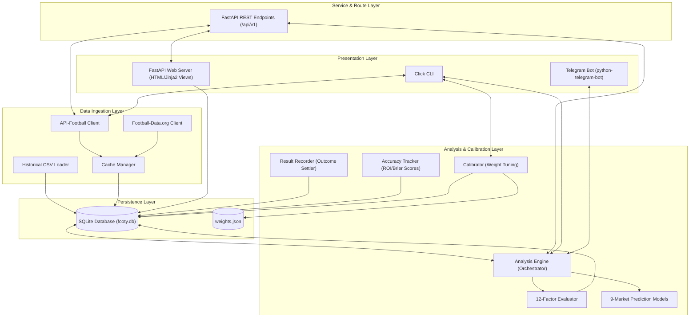
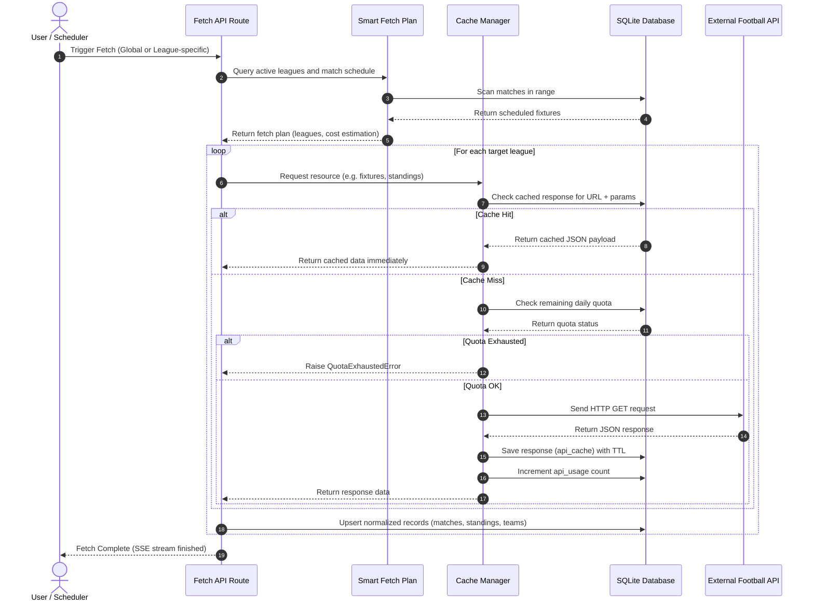
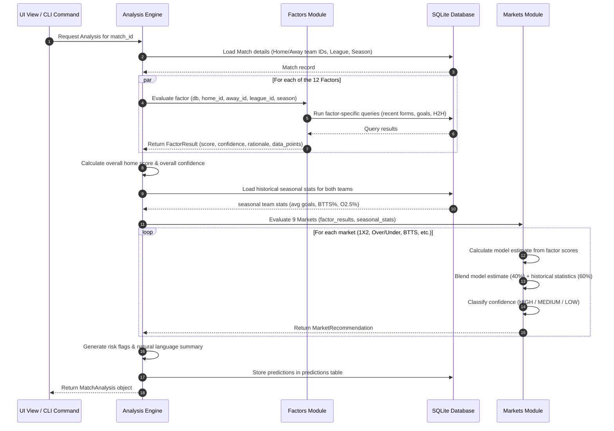
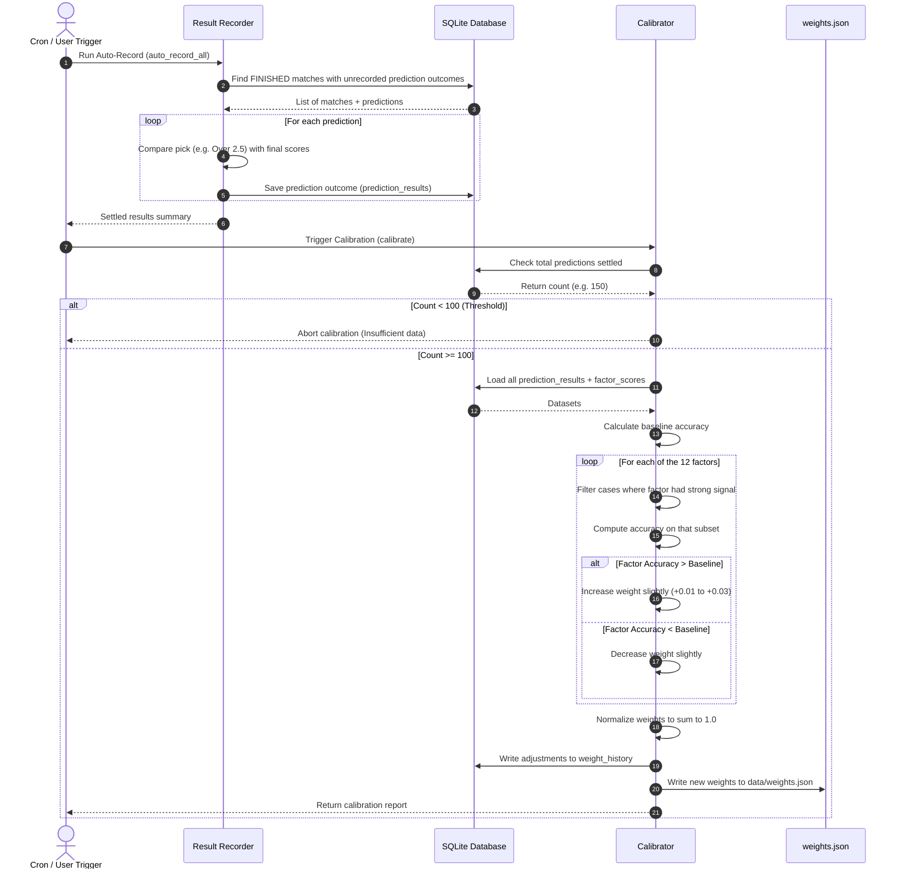

# Footy Predict — Architecture Design Document

This document provides a comprehensive overview of the architectural design, data pipelines, persistence layers, and mathematical models underpinning the Footy Predict decision support system.

---

## 1. System Philosophy & Design Goals

Footy Predict is built around the following core engineering principles:

*   **Local-First & Offline Capabilities**: The primary database is a local SQLite file (`footy.db`). The system runs entirely on the host machine, performing calculations locally without relying on external cloud databases or SaaS scoring endpoints.
*   **Decision Support vs. Automated Betting**: The system is designed to provide clean, structured data, confidence ratings, and reasoning parameters to help human operators build parlays. It does not automate bet placements.
*   **Quota-Constrained Data Ingestion**: The system is tailored to fit the limitations of free API tiers, specifically API-Football's 100 requests/day limit. Caching and scheduled sync strategies are optimized to prevent rate-limiting or quota exhaustion.
*   **Self-Correcting Calibration**: The system tracks its own predictions and automatically calibrates factor weights over time. It measures which analysis dimensions correspond with correct outcomes and adjusts weights to improve accuracy.

---

## 2. High-Level System Architecture

Footy Predict follows a layered architecture pattern, separating data ingestion, persistence, analysis, and presentation.



### Layer Definitions

1.  **Presentation Layer**: Direct interfaces for users. The Web Server serves Jinja2 templates styled with a premium macOS-inspired dark/light theme. The Click CLI handles script execution, administrative tasks, and text-based report rendering. The Telegram Bot provides mobile alerts, picks, and matchweek reports.
2.  **Service & REST Layer**: A FastAPI routing system that exposes endpoints `/api/v1/...` for asynchronous interactions, background sync tasks, parlay builder operations, settings management, and data feeds.
3.  **Analysis & Calibration Layer**: The analytical core. The `AnalysisEngine` runs match-specific factors, feeds scores into the `MarketRecommendation` models, records final match outcomes, computes accuracy metrics, and calibrates factor weights.
4.  **Data Ingestion Layer**: Responsible for retrieving raw information. Includes clients for API-Football (primary) and Football-Data.org (secondary), a CSV loader for importing football-data.co.uk statistics, and a Cache Manager that intercepts API queries.
5.  **Persistence Layer**: Comprises the SQLite file database (`footy.db`) and a local file store (`data/weights.json`) which persists the running weights of the analysis factors.

---

## 3. Data Pipelines & Flows

Footy Predict operates three main pipelines: Ingestion, Analysis, and Calibration.

### A. The Data Ingestion & Sync Pipeline

This pipeline ensures the local database stays updated without exceeding daily API quotas.



1.  **Fetch Strategy Assessment**: The client requests a sync. The `fetch` service consults the `get_smart_fetch_plan` module, which checks the current day of the week and scheduled matches to determine which leagues need updates.
2.  **Cache Verification**: The API client computes a SHA-256 hash of the request URL and query parameters. If a cache record exists and its expiration timestamp is in the future, the JSON payload is read from SQLite and returned immediately, avoiding an HTTP request.
3.  **Quota Verification**: If the request is a cache miss, the system queries the `api_usage` table to count requests made today. If the count exceeds the safety threshold (e.g., 100), the request is aborted to prevent overages.
4.  **Network Query & Cache Save**: The network request is made. On success, the response JSON is written to `api_cache` with a specific Time-to-Live (TTL) (e.g., 6 hours for fixtures, 24 hours for standings). The daily request counter is incremented.
5.  **Normalization & Database Insertion**: The raw nested JSON from the API is parsed and flattened into normalized SQLite schemas (e.g., mapping team names to local primary keys, writing goals/shots to `match_stats`, mapping match statuses).

### B. The Match Analysis & Market Prediction Pipeline

This pipeline runs locally and generates betting recommendations when a user views a match.



1.  **Fact-Gathering**: The `AnalysisEngine` retrieves the match metadata (teams, season, league).
2.  **Factor Evaluation**: 12 independent analysis factors run in parallel. Each factor queries relevant segments of the database (e.g., the last 10 games for recent form, historical meetings for H2H, days since the last fixture for rest days).
3.  **Weighted Score Aggregation**: The overall home advantage score ($S$) and confidence ($C$) are computed using a weighted average. Factors with low confidence contribute less to the total, preventing incomplete data from skewing the results:
    $$S = \frac{\sum_{i=1}^{12} (s_i \cdot w_i \cdot c_i)}{\sum_{i=1}^{12} (w_i \cdot c_i)}$$
    Where $s_i$ is the factor score (-1 to +1), $w_i$ is the factor weight, and $c_i$ is the factor confidence (0 to 1).
4.  **Market Blending**: The aggregated factor scores and raw team season statistics are fed into the prediction models. For each market, a model-derived probability is blended with observed historical frequencies (60% weight on history, 40% on factors):
    $$P_{\text{final}} = 0.6 \cdot P_{\text{historical}} + 0.4 \cdot P_{\text{model}}$$
5.  **Persistence**: The resulting recommendations are saved in the `predictions` table, making them available for accuracy tracking once the match finishes.

### C. The Settlement & Learning Pipeline

This pipeline closes the loop by evaluating prediction accuracy and adjusting factor weights.



1.  **Outcome Processing**: When a fetch completes, `ResultRecorder.auto_record_all` finds completed matches in the database that have predictions but no recorded results. It evaluates the predictions against the final scorelines and records the outcomes in the `prediction_results` table.
2.  **Calibration Check**: The `Calibrator` verifies that at least 100 predictions have been settled before running a calibration.
3.  **Signal Analysis**: For each of the 12 factors, the calibrator identifies predictions where the factor had a strong signal (e.g., $|score| > 0.3$ and $confidence > 0.4$).
4.  **Weight Adjustments**: The accuracy of the predictions in each factor's subset is compared against the overall baseline accuracy of the system.
    *   If a factor's subset was **more accurate** than the baseline, its weight is increased.
    *   If a factor's subset was **less accurate**, its weight is decreased.
5.  **Normalization & Persistence**: To prevent weights from drifting, the updated values are re-normalized to sum to exactly 1.0. The changes are recorded in the `weight_history` table for audit tracking, and the new weights are saved to `data/weights.json`.

---

## 4. SQLite Database Design & Optimization

The database layer uses SQLite in Write-Ahead Log (WAL) mode to manage concurrent read and write operations efficiently.

### Database Optimizations

*   **Write-Ahead Logging (WAL)**: Enabled via `PRAGMA journal_mode=WAL`. This allows readers to continue accessing the database while a background task writes new data, preventing lock contention during sync operations.
*   **Foreign Key Constraints**: Enforced using `PRAGMA foreign_keys=ON` to maintain referential integrity.
*   **Performance Indexes**: Indexes are placed on columns that are frequently used in query filters and joins:
    *   `idx_matches_date` on `matches(date)` optimizes timeline queries.
    *   `idx_matches_league` on `matches(league_id, season)` speeds up matchweek scans.
    *   `idx_matches_teams` on `matches(home_team_id, away_team_id)` speeds up head-to-head calculations.
    *   `idx_cache_key` and `idx_cache_expires` on `api_cache` optimize cache hits and cache clearing.

---

## 5. API Cache & Quota Management

Managing API usage is critical because the free tier of API-Football provides only 100 requests per day. The system uses two main strategies to manage this limit: a sliding window rate limiter and a scheduled sync strategy.

### A. Sliding Window Rate Limiter
The `APIFootballClient` uses an in-memory sliding window to enforce the rate limit of 10 requests per minute. It records the timestamp of each outgoing call. Before making a new request, it removes timestamps older than 60 seconds and checks the remaining slots. If the limit is reached, it pauses execution until a slot opens up:

```python
# Sliding window rate limiting
now = time.time()
self._request_timestamps = [t for t in self._request_timestamps if now - t < 60]
if len(self._request_timestamps) >= self.rate_limit:
    sleep_time = 60 - (now - self._request_timestamps[0])
    await asyncio.sleep(sleep_time)
```

### B. Smart Fetch Scheduling
The `get_smart_fetch_plan` function adjusts the data synchronization scope depending on the day of the week:

*   **Midweek (Monday–Wednesday)**: The system only synchronizes data for leagues that have matches scheduled within the next 3 days. This saves requests when fewer games are being played.
*   **Weekend Preparation (Thursday–Friday)**: The system performs a full sync for all enabled leagues to prepare preview data and calculate predictions for the weekend.
*   **Weekend (Saturday–Sunday)**: The system syncs only the leagues that have matches scheduled for today or tomorrow, ensuring live scores and completed match results are captured quickly.
*   **Empty Database Bootstrap**: If the matches table is empty, the system automatically bypasses the schedule and triggers a full sync for all enabled leagues to populate the database.

---

## 6. Feedback Loop & Calibration Algorithm

The calibration process tunes the factor weights incrementally to improve accuracy while avoiding overfitting.

### Key Tuning Constants
*   `SIGNAL_THRESHOLD_SCORE = 0.3`: The minimum factor score required to indicate a strong preference for home ($>0.3$) or away ($<-0.3$).
*   `SIGNAL_THRESHOLD_CONFIDENCE = 0.4`: The minimum confidence level required for a factor's score to be considered reliable.
*   `MAX_ADJUSTMENT = 0.03`: The maximum amount a factor's weight can be adjusted in a single calibration run.
*   `MIN_WEIGHT = 0.005`: The minimum weight threshold, ensuring that no factor is completely disabled by calibration.

### Calibration Logic
1.  **Baseline Calculation**: Compute the baseline accuracy ($A_{\text{base}}$) across all settled predictions:
    $$A_{\text{base}} = \frac{N_{\text{correct}}}{N_{\text{total}}}$$
2.  **Factor Accuracy Calculation**: For each factor $f$, find the subset of predictions where the factor showed a strong, reliable signal ($|s_f| > 0.3$ and $c_f > 0.4$). Calculate the accuracy ($A_f$) within this subset:
    $$A_f = \frac{N_{\text{correct, } f}}{N_{\text{signal, } f}}$$
    *(Note: A factor must have at least 15 signal predictions to be eligible for calibration.)*
3.  **Weight Adjustment**: Calculate the performance variance ($D_f = A_f - A_{\text{base}}$) and nudge the factor's weight ($w_f$):
    $$w_f^{\text{temp}} = w_f + \text{clamp}(0.1 \cdot D_f, -\text{MAX\_ADJUSTMENT}, \text{MAX\_ADJUSTMENT})$$
4.  **Normalization**: Normalize all weights to ensure they sum to exactly 1.0, and clamp them to ensure no weight falls below `MIN_WEIGHT` ($0.005$):
    $$w_f^{\text{final}} = \max\left(\text{MIN\_WEIGHT}, \frac{w_f^{\text{temp}}}{\sum w_i^{\text{temp}}}\right)$$
5.  **Normalization Pass**: Run a second normalization pass to correct any drift introduced by the clamping step.
